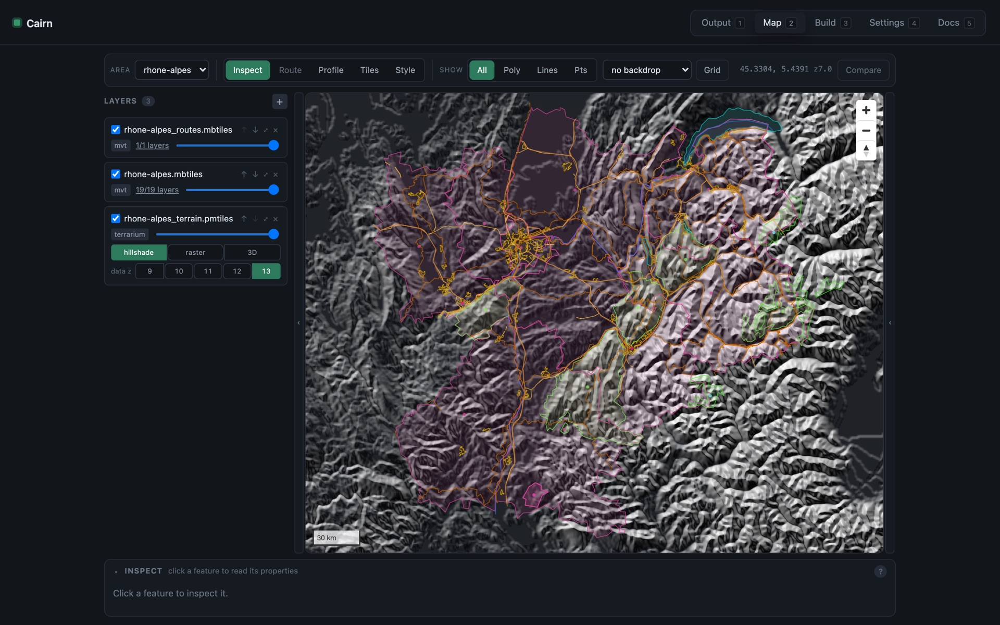
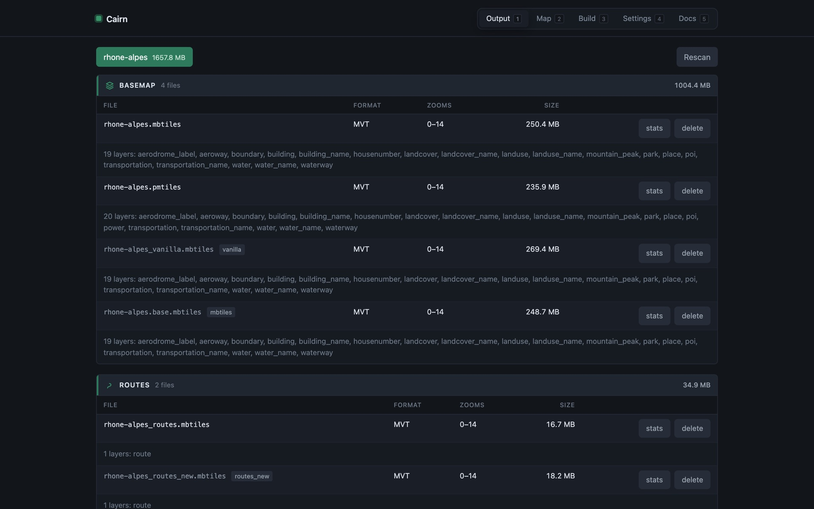
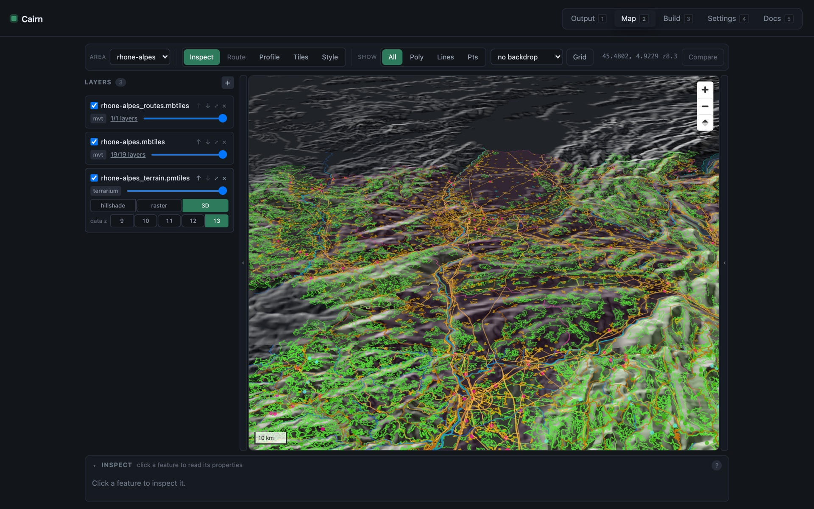

<p align="center">
  
</p>

<h1 align="center">Cairn</h1>

<p align="center">
  <strong>Build your own offline maps.</strong><br>
  Vector tiles, terrain and routing from OpenStreetMap, for any area on Earth —<br>
  from a desktop app or a command line, over one pipeline.
</p>

<p align="center">
  <a href="https://github.com/Akylas/cairn/actions/workflows/ci.yml"></a>
  <a href="https://github.com/Akylas/cairn/releases/latest"></a>
  <a href="LICENSE"></a>
  <a href="https://akylas.github.io/cairn/"></a>
</p>

<p align="center">
  
</p>

A cairn is a stack of stones that marks the route. This one builds the map.

Cairn turns a Geofabrik extract into everything an offline outdoor map needs: a vector basemap, hiking
and cycling routes, shaded relief and 3D terrain, and a [Valhalla](https://github.com/valhalla/valhalla)
routing package with elevation baked in. It began as the build tool behind
[AlpiMaps](https://github.com/Akylas/alpimaps).

The outputs are ordinary MBTiles, PMTiles and a Valhalla tar, so they work just as well with
`tileserver-gl`, QGIS, MapLibre, or anything else that reads them.

## What it produces

| Output | What it is |
| --- | --- |
| `${AREA}.mbtiles` | [OpenMapTiles](https://openmaptiles.org)-schema vector basemap, z0–14 |
| `${AREA}_routes.mbtiles` | hiking and cycling route relations, kept in their own archive |
| `${AREA}_terrain.mbtiles` | terrain-RGB elevation, for shaded relief and 3D |
| `${AREA}.vtiles` | the Valhalla routing package, with elevation baked in |

## Highlights

* **One pipeline, two front ends.** The desktop app plans a run and skips what is already built; the
  command line runs exactly what you typed. Both call the same Rust core, so they produce the same bytes.
* **Every option documented, with its cost.** `cairn options basemap` lists each flag with what it does to
  the archive's size. Defaults are the measured set: **−11.7 %** on the basemap and **−19.4 %** on routes
  against planetiler's own defaults, for rhone-alpes.
* **Native where it counts.** The terrain-RGB renderer and the Valhalla packager are Rust, with no GDAL or
  PROJ. Routing runs in-process against the package you just built — no `valhalla_service`, no zmq.
* **Look at what you built.** A map view inspects, routes, profiles elevation, dumps raw tile contents (MVT or
  MLT), restyles an archive live and compares two builds side by side.
* **Honest about "built".** A step is done when its files are on disk — however they got there. Delete a file
  and the step runs again.

## Install

**Download** the app or the standalone `cairn` command line from the
[latest release](https://github.com/Akylas/cairn/releases/latest) (macOS and Linux).

The planetiler steps need **Java 21+**. The app can fetch a JRE on first run, and both front ends fetch the
planetiler jar on first use. OSM extracts, elevation tiles and the Valhalla graph are downloaded per area;
none of it is bundled.

**Build from source** — see [Building](#building-from-source).

## Quick start

With the command line:

```shell
export AREA=rhone-alpes

cairn download --area $AREA          # OSM extract from Geofabrik
cairn basemap  --area $AREA          # vector basemap
cairn routes   --area $AREA          # route relations
cairn elevation --area $AREA         # .hgt tiles
cairn terrain  --area $AREA          # terrain-RGB
cairn valhalla-tiles --area $AREA    # routing graph
cairn package  --area $AREA          # Valhalla package
```

Every step clips to the area's own boundary, downloading the `.poly` from Geofabrik the first time it needs
it. To clip to something else, pass a polygon: `--polygon` (basemap, routes), `--poly-shape` (terrain) or
`--poly` (package). [`examples/areas/`](examples/areas/) has two to start from.

`cairn state --area $AREA` reports which outputs exist; `cairn state --area $AREA clear <step>` removes one.
`cairn serve` serves the result over HTTP, and `cairn catalog --stats` lists what is built.

With the app: launch it, pick an area, tick the steps, and watch the progress. Selecting only *Valhalla
package* runs `Download OSM → Elevation tiles → Valhalla tiles → Valhalla package` — the steps carry their
dependencies. See [docs/getting-started.md](docs/getting-started.md) for a guided first build.

<p align="center">
  
</p>

## Tuning

Each step's defaults reproduce the builds documented in
[docs/pipeline-reference.md](docs/pipeline-reference.md) — an untouched run gives you the same bytes as the
reference pipeline. Tests parse that document and compare it against the defaults, so the two cannot drift
apart.

```shell
cairn options basemap            # every flag, with what it costs
cairn options basemap --presets  # and the option sets that ship
```

Two presets ship per planetiler step: `measured` (the default) and `stock` (planetiler's own defaults, as a
comparison baseline). Override anything with `-o`, and pass anything planetiler knows after `--`:

```shell
cairn basemap --area $AREA -o transportation_surface_detail=false
cairn basemap --area $AREA --preset stock
cairn basemap --area $AREA -- --max-point-buffer=4
```

Some flags worth knowing about, all measured on a rhone-alpes build:

| Flag | Effect |
| --- | --- |
| `max_point_buffer=4` | caps the buffer on point layers. `place` declares 256px — nine times a tile's own area — so leaving it uncapped costs tens of MB |
| `landcover_merge_maxzoom` | merges landcover polygons at z14, where most of the bytes are. −19% of that layer |
| `transportation_surface_detail` | road surface and tracktype on every class, +0.84%. Reaches 73% of tracks — the difference between riding and pushing |
| `water_pool_tolerance=1` | simplifies swimming pools, which carry ~99 vertices each for a shape a pixel across |
| `drop_redundant_name_int` | omits `name_int` where it duplicates `name`, −0.88% |
| `poi_custom_ranks` | orders POI labels for an outdoor map (pharmacy, drinking water and bakery ahead of schools) instead of OpenMapTiles' order |
| `poi_trees`, `poi_landmarks`, `poi_guideposts` | trees, landmarks (power towers, pylons, crosses, cairns…) and guideposts from z14, unnamed ones packed into one MultiPoint per tile. +0.3%, +0.23%, +0.09% |
| `power_lines` | overhead transmission lines from z14 in a new `power` layer, +0.11% |

## The desktop app

| | |
| --- | --- |
| **Output** | every artifact of every area, with format, zoom range and size, and per-layer statistics |
| **Map** | Inspect · Route · Profile · Tiles · Style, with stacked layers per side and a swipe comparison |
| **Build** | choose steps, edit each step's options as a form, save presets, read the live log, cancel for real |
| **Settings** | every path and tool, and where each one resolved to on this machine |
| **Docs** | what each step and mode does, read from the same source as the command line |

Terrain archives render as **hillshade**, as **raster** (the encoded bytes, so quantisation banding and the
seam between two sources show as themselves), or in **3D**, which is how tile edges give themselves away — a
mismatched edge is a cliff.

<p align="center">
  
</p>

## Building from source

You need Rust (stable), Node 20+, and Java 21+. Then the native libraries the elevation and routing steps
need:

```shell
# macOS
brew install aria2 gdal autoconf automake zmq czmq spatialite-tools luajit

# Ubuntu
sudo add-apt-repository ppa:ubuntugis/ubuntugis-unstable
sudo apt install -y aria2 gdal-bin autoconf automake pkg-config libtool make gcc g++ cmake \
  curl unzip jq protobuf-compiler vim-common locales libcurl4-openssl-dev zlib1g-dev \
  liblz4-dev libprotobuf-dev spatialite-tools luajit
```

```shell
git clone --recurse-submodules https://github.com/Akylas/cairn
cd cairn
npm install
npm run build:tools                    # planetiler jar, Valhalla, tippecanoe

cargo build --release -p cairn-cli     # target/release/cairn-cli
npm run tauri dev                      # the app, with hot reload
```

Linking Valhalla is opt-in: without a built `valhalla/build` the crates compile as before and routing reports
itself unavailable. [CONTRIBUTING.md](CONTRIBUTING.md) lists the everyday commands.

## Documentation

* [Getting started](docs/getting-started.md) — a first build, end to end
* [Pipeline reference](docs/pipeline-reference.md) — every step as a raw tool invocation
* [Internals](docs/internals.md) — how it fits together, and what went wrong on the way
* [Design notes](docs/design-notes.md) — the original plan and the decisions it settled

## Repository layout

| Path | |
| --- | --- |
| `crates/core/` | `cairn-core`: the pipeline, shared by both front ends |
| `crates/cli/` | the `cairn` command line |
| `src-tauri/`, `src/` | the desktop app: Tauri shell and Svelte UI |
| `config/` | default Valhalla and elevation-source configuration |
| `examples/` | sample areas |
| `docs/` | documentation |
| `scripts/` | packaging, release and bathymap scripts |
| `site/` | the [project website](https://akylas.github.io/cairn/) |
| `tools/legacy/` | the original shell and Python pipeline, still runnable |
| `tools/bench/` | the benchmarks behind the shipped presets |
| `planetiler/`, `valhalla/`, `tippecanoe/`, … | vendored tools, as submodules |

## Related

The planetiler fork carries the schema work this project depends on — POI selection, the landcover and route
tuning, road surface detail. Changes land in
[farfromrefug/planetiler-openmaptiles](https://github.com/farfromrefug/planetiler-openmaptiles) and are picked
up here as a submodule bump.

## Contributing

Issues and pull requests are welcome — read [CONTRIBUTING.md](CONTRIBUTING.md) first, and the
[Code of Conduct](CODE_OF_CONDUCT.md). Report security problems privately: [SECURITY.md](SECURITY.md).

## License

[MIT](LICENSE). Cairn builds on and bundles other projects under their own licenses — see
[THIRD_PARTY_NOTICES.md](THIRD_PARTY_NOTICES.md).

**Map data is not covered by that license.** OpenStreetMap data is © OpenStreetMap contributors, available
under the [ODbL](https://www.openstreetmap.org/copyright); tiles you build and publish carry its attribution
and share-alike terms.
